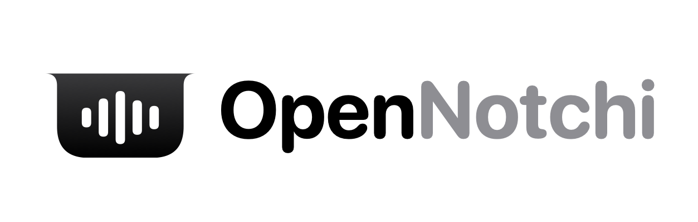

<p align="center"></p>

# OpenNotchi

A free, open-source "dynamic notch" for macOS: hover the MacBook notch to get
now-playing controls, battery status, and a file tray with AirDrop. An
alternative to paid apps like NotchNook and Alcove.

## Features

- **Notch that expands on hover**, matching the physical camera housing (falls
  back to a pill on displays without a notch)
- **Now Playing** for **Spotify** and **Apple Music**: artwork, title/artist,
  seekable progress bar, play/pause/next/previous
- **Synced lyrics** from [LRCLIB](https://lrclib.net) (free, no API key): a
  Lyrics tab that follows the song, plus the current line under the title on Home
- **Live activity** while closed: artwork and waveform beside the notch
- **Tray**: drag files onto the notch to park them, drag them back out later,
  double-click to open, right-click for Finder/AirDrop
- **AirDrop**: drop files on the AirDrop zone to send them right away
- **Clipboard history**: text and images, searchable, click to copy again.
  Skips items password managers mark as concealed
- **Calendar**: today's upcoming events next to the player
- **Timer**: Pomodoro-style presets, countdown shown beside the notch while closed,
  sound + notification when done
- **Mirror**: quick camera preview
- **Global shortcut** ⌥⌘N to toggle the notch; clicking elsewhere closes it
- **Themes**: Liquid Glass (macOS 26+), Liquid Glass Clear, Frosted, Music
  Adaptive (colors from the current cover), Album Art (blurred cover), Midnight,
  Aurora, Classic Black
- **Accent color** from the music, your Mac's accent, or a fixed color
- **Border & shape**: none / subtle / accent / music gradient / rainbow border,
  adjustable width and corner radius
- **Battery** level and charging state
- Settings: launch at login, hover delay, haptics, per-feature toggles, media sources

## Download

Grab the latest `.dmg` from the [Releases page](https://github.com/nannndev/OpenNotchi/releases/latest),
open it and drag OpenNotchi into Applications. The app isn't notarized yet, so
on first launch go to **System Settings → Privacy & Security** and click
**Open Anyway**.

## Requirements

- macOS 14 Sonoma or later (works best on a MacBook with a notch)
- Xcode 16+ / Swift 5.10+ toolchain

## Build & run

All commands run from the repo root (`make help` lists them):

```bash
make run        # debug build of the app, then launch it
make app        # release build
make install    # release build, copied to /Applications
make dist       # universal .dmg + .zip in apps/macos/dist
make web        # landing page at http://localhost:5173
make brand      # regenerate icon, logo and web assets
```

You can also open `apps/macos/Package.swift` in Xcode to edit the code. Run through
`make run` rather than Xcode, though: the app needs its `Info.plist` (from the
`.app` bundle) for the Automation permission prompt.

On first use macOS asks to let OpenNotchi control Spotify / Music. If you said
no, re-enable it in **System Settings → Privacy & Security → Automation**.
Ad-hoc signed debug builds may ask again after a rebuild.

### Scripting

Other tools can drive the notch with a distributed notification named
`io.github.opennotchi.command` whose object is `open`, `close`, `toggle`, or a
tab name (`home`, `lyrics`, `tray`, `clipboard`, `timer`, `mirror`), or
`settings`.

## Project layout

This is a small monorepo:

```
OpenNotchi/
├── apps/
│   ├── macos/          the app (Swift Package)
│   │   ├── Sources/OpenNotchi/
│   │   │   ├── App/       entry point, AppDelegate, menu bar, brand mark
│   │   │   ├── Notch/     floating panel, notch shape, hover/open state
│   │   │   ├── Views/     SwiftUI: home, lyrics, tray, clipboard, timer, settings
│   │   │   ├── Media/     Spotify / Apple Music, artwork colors, lyrics
│   │   │   ├── Theme/     themes, accents, borders
│   │   │   ├── Features/  clipboard, timer, calendar, camera
│   │   │   ├── System/    battery (IOKit), global hotkey (Carbon)
│   │   │   ├── Tray/      tray storage, AirDrop
│   │   │   └── Settings/  persisted preferences
│   │   ├── Resources/     Info.plist, AppIcon.icns
│   │   └── scripts/       build, package, release
│   └── website/        landing page (React, Vite, Tailwind, shadcn/ui)
├── brand/              brand guide and asset generator
├── .github/workflows/  CI and release
└── CHANGELOG.md
```

### Adding a media source

Implement `MediaProvider` (see `apps/macos/Sources/OpenNotchi/Media/SpotifyProvider.swift`)
and add it to `MediaManager.providers`.

## Roadmap

- [ ] Browser / YouTube playback (system-wide Now Playing)
- [ ] Volume & brightness HUD replacement
- [ ] Customizable shortcut
- [ ] Multi-display support
- [ ] Signed & notarized releases, Homebrew cask

## Releases & versioning

OpenNotchi uses [Semantic Versioning](https://semver.org/); changes are listed
in [CHANGELOG.md](CHANGELOG.md). To cut a release:

1. Add a `## [X.Y.Z] - YYYY-MM-DD` section to `CHANGELOG.md` and commit it.
2. Run `make release VERSION=X.Y.Z`.

This bumps the version in `apps/macos/Resources/Info.plist`, tags `vX.Y.Z` and pushes.
GitHub Actions then builds a universal (Apple Silicon + Intel) app and publishes
`OpenNotchi.dmg` / `.zip` on the release. `make dist` builds the same files
locally into `apps/macos/dist/`.

## Website

The landing page lives in [apps/website/](apps/website/) (React, Tailwind,
shadcn/ui) and deploys to Vercel with Root Directory `apps/website`.

## Brand

Logo, colors and usage rules are in [brand/BRAND.md](brand/BRAND.md). Run
`make brand` to regenerate every asset.

## License

MIT. See [LICENSE](LICENSE).
# OpenNotchi
